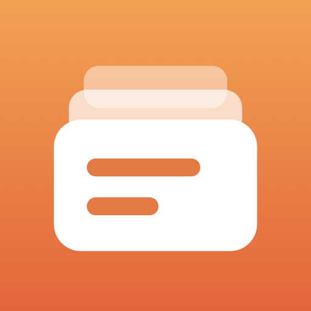

<div align="center">



# ReCopy

**Copy once, paste anytime.**

A clipboard history for macOS that remembers text, links, colours, e-mail addresses, images and files.<br>
Your history lives in a folder you choose, so iCloud Drive, Google Drive or OneDrive can sync it between your Macs.

[](https://github.com/lazycatlabs/recopy/releases/latest)
[](https://github.com/lazycatlabs/recopy/releases)


[](LICENSE)

[**Download for Mac**](https://github.com/lazycatlabs/recopy/releases/latest) · [Features](#features) · [Install](#install) · [Shortcuts](#shortcuts) · [Your data](#your-data) · [FAQ](#faq) · [Development](#development) · [Sponsors](#sponsors) · [License](#license)

</div>

## Features

**Press ⇧⌘V anywhere, find what you copied, paste it back.**

| | |
| --- | --- |
| 🔎 **Knows what you copied** | Text, links, e-mail addresses, colours (`#HEX`, `rgb()`, `hsl()`), images and files, each with its own icon. Filter by type or by the day it was first copied. |
| 🌐 **Link previews** | Links show their site's favicon, page title and preview image. |
| 🖼️ **Text in images** | Text in copied screenshots is recognised on your Mac, so you can search for it. |
| 📌 **Pin** | Pinned entries stay at the top and are never cleaned up. |
| 🗓️ **Sections by time** | Pinned, Today, Yesterday, This Week, This Month, then by month. |
| ℹ️ **Details** | Source app, type, characters and words, image size, how many times it was copied and pasted, and when first and last. |
| ✍️ **Annotate images** | Pen, highlighter, rectangle and arrow, saved as a new entry and put on the clipboard. |
| ⚡ **Actions per type** | Paste, copy, open a link, write an e-mail, copy a colour as HEX, RGB or HSL, save an image or text to a file, show a file in Finder. |
| 🔒 **Private by default** | Passwords marked as secret by any app are never recorded, and you can ignore whole apps (Passwords and Keychain Access are ignored from the start). |
| 🎛️ **Yours to tune** | Change the shortcut, keep history from a day to forever, text size, copy and paste sounds, toasts, open at login. |
| 📥 **Import from Raycast** | Brings in the images and rich-text copies Raycast keeps. |

> [!TIP]
> Double-click an entry to copy it and close the window, or press **↩** to paste it straight into the app you were in.

## Install

Requires macOS 26 Tahoe or later.

**Homebrew**

```bash
brew install --cask lazycatlabs/tap/recopy
```

**Or download the DMG** from [Releases](https://github.com/lazycatlabs/recopy/releases/latest), open it and drag **ReCopy** to Applications. A zip of the same app is there too.

> [!NOTE]
> **First launch.** ReCopy isn't notarized yet, so macOS blocks it the first time:
>
> 1. Open ReCopy.
> 2. Go to **System Settings → Privacy & Security**.
> 3. Click **Open Anyway**, once.

ReCopy lives in the menu bar. On first launch it asks for a folder for your history: pick one inside iCloud Drive, Google Drive or OneDrive to share it between Macs.

<details>
<summary><b>Build from source</b></summary>

```bash
open ReCopy.xcodeproj
```

Choose the **ReCopy** scheme and press **⌘R**. To build the DMG and zip a release uses:

```bash
scripts/make_release.sh
```

</details>

## Shortcuts

In the clipboard window:

| Keys | Does |
| --- | --- |
| **⇧⌘V** | Open or close the window, from any app (change it in Settings) |
| **↑ ↓** | Select |
| **↩** | Paste into the app you were in |
| **⌘↩** or double-click | Copy and close |
| **⌘1 … ⌘9** | Paste one of the first nine entries |
| **⌘K** | All actions for the selected entry |
| **⌘P** | Pin or unpin |
| **⌘O** | Open the link, file or e-mail |
| **⌘E** | Annotate an image |
| **⌘S** | Save an image or text to a file |
| **⌘⌫** | Delete |
| **⌘,** | Settings |
| **esc** | Close the actions, clear the search, then close the window |

## Permissions

| Permission | Why |
| --- | --- |
| **Accessibility** | Send ⌘V to the app you were in, so ↩ pastes. Without it, ReCopy copies and you paste yourself. |

> [!IMPORTANT]
> macOS ties the permission to the app's signature. If it stops working after an update, remove ReCopy from **System Settings → Privacy & Security → Accessibility** and grant it again.

## Your data

Everything stays in the folder you picked. There are no accounts and no analytics; the only network requests fetch a copied link's title and preview image (you can turn that off).

```
<your folder>/
├── .copaste/config.json   settings shared by your Macs
├── items/<id>.json        one small file per entry
└── blobs/                 images, favicons and link previews
```

One file per entry keeps cloud sync quick and conflicts small. The shortcut, text size and folder location are kept per Mac.

## FAQ

<details>
<summary><b>Can I move my Raycast clipboard history?</b></summary>

Partly. **Settings → Import → Import from Raycast…** brings in the images and rich-text copies Raycast keeps as files. Raycast encrypts the rest (plain text, copy counts, source apps), so those can't be moved. Entries already in ReCopy are skipped, so you can run it again.

</details>

<details>
<summary><b>Is there an iPhone app?</b></summary>

Not now. ReCopy is macOS only.

</details>

<details>
<summary><b>Something's wrong. Where do I report it?</b></summary>

Use **Report a Bug** in the menu bar or in Settings → About. It opens an e-mail to admin@lazycatlabs.com with your app and macOS versions filled in.

</details>

## Development

You'll need Xcode 26 or later. The app is built in the Swift 6 language mode with main-actor isolation by default, and the project uses synchronized folders, so new files are picked up automatically. [AGENTS.md](AGENTS.md) describes the architecture and conventions.

```bash
git clone https://github.com/lazycatlabs/recopy.git
```

```bash
cd recopy && open ReCopy.xcodeproj
```

Unit tests:

```bash
xcodebuild -project ReCopy.xcodeproj -scheme ReCopy -destination 'platform=macOS' test
```

UI text comes from `scripts/strings.py` (English and Indonesian). After editing it:

```bash
python3 scripts/strings.py
```

<details>
<summary><b>Project layout</b></summary>

Clean Architecture, feature-first: **DataSource → Repository → UseCase / ClipboardSession → View**.

```
ReCopy/
  App/                 @main, menu bar, global shortcut, composition root (AppContainer, ClipboardSession)
  Core/                Design tokens, vault storage, logging, shortcut store, toasts, sounds
  Features/
    Clipboard/         Entries, type detection, history rules, the floating window
    Annotate/          Image annotation editor
    Settings/          Settings, support links
    Vault/             Choosing the history folder
    Migration/         Import from Raycast
ReCopyTests/          Swift Testing
scripts/               String catalog generator, release packaging
```

</details>

<details>
<summary><b>Releasing</b></summary>

1. Bump `MARKETING_VERSION` and `CURRENT_PROJECT_VERSION` in `ReCopy.xcodeproj/project.pbxproj` and add a section to `CHANGELOG.md`.
2. `scripts/make_release.sh` builds `build/ReCopy-<version>.dmg` and `.zip` and prints the zip's sha256.
3. Tag and publish: `gh release create v<version> build/ReCopy-<version>.dmg build/ReCopy-<version>.zip --notes-file <notes>`.
4. Update `version` and `sha256` in `Casks/recopy.rb` in [lazycatlabs/homebrew-tap](https://github.com/lazycatlabs/homebrew-tap).

</details>

<details>
<summary><b>Diagnostics</b></summary>

```bash
/usr/bin/log show --last 5m --predicate 'subsystem == "com.lazycatlabs.recopy"'
```

</details>

## Sponsors

ReCopy is free and open source. If it saves you time, you can support its development on
[GitHub Sponsors](https://github.com/sponsors/Lzyct) — or from Settings › About › Sponsor on GitHub in the app.

<!-- sponsors --><!-- sponsors -->

Thank you to everyone above. Your avatar shows up here (updated daily) once you sponsor.

## License

Copyright © 2026 Lazycat Labs.

ReCopy is free software: you can redistribute it and/or modify it under the terms of the
[GNU General Public License, version 3](LICENSE) or (at your option) any later version. It is distributed in the hope
that it will be useful, but **without any warranty**; without even the implied warranty of merchantability or fitness
for a particular purpose. See [LICENSE](LICENSE) for the full text.

Website: [recopy.lazycatlabs.com](https://recopy.lazycatlabs.com)
